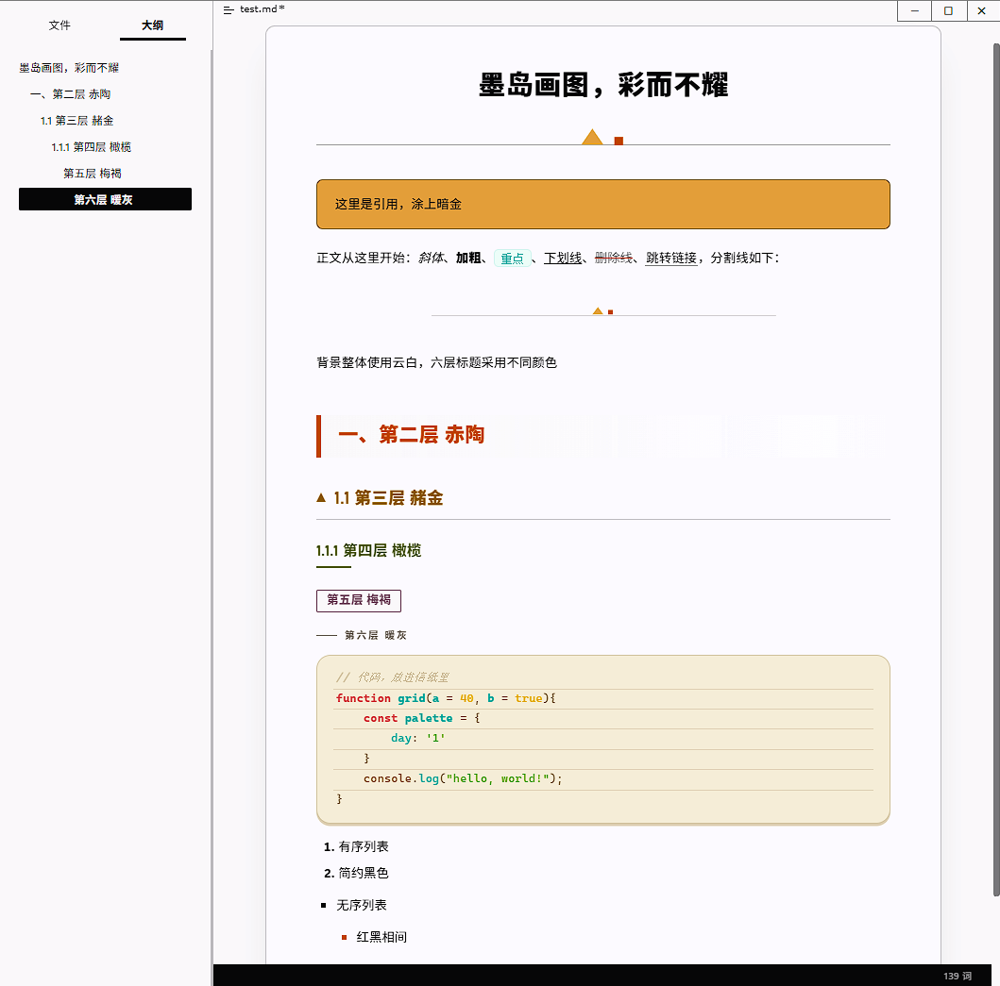

# Graphite Island Spectrum · a Typora theme

> A soft Bauhaus theme: five colours, six heading tones, geometry instead of ornament.
> Graphite draws the structure, warm paper holds the air, and two warm accents do all the talking.



## Install

1. Download this repository, or just take `graphite-island-spectrum.css`.
2. Put `graphite-island-spectrum.css` in Typora's theme folder
   (**Preferences → Appearance → Open Theme Folder**). Keep it at the top level of that folder.
3. Pick **Graphite Island Spectrum** from the **Themes** menu. If nothing changes, restart Typora
   (it caches theme styles until relaunched).

The menu entry comes from the filename: `graphite-island-spectrum.css` → *Graphite Island Spectrum*.

## Design

### Five colours, no more

| token | hex | what it does |
| --- | --- | --- |
| `--bb-ink` | `#1D1D1F` | all text, 1px structure lines, dark surfaces |
| `--bb-paper` | `#FBFBFD` | page and card background |
| `--bb-amber` | `#D8A24B` | triangles, highlights, colour fills, blockquote ground |
| `--bb-clay` | `#BF4800` | squares, states, primary button, hover, danger |
| `--bb-mist` | `#F5F5F7` | grey blocks, the 40px drafting grid, separators |

Every other colour in the theme is one of these five, stated as a tint or a shade — no sixth hue sneaks in.

### Six heading levels, six tones

| level | tone | hex |
| --- | --- | --- |
| H1 | graphite | `#1D1D1F` |
| H2 | clay | `#BF4800` |
| H3 | ochre | `#8A5E14` |
| H4 | olive | `#55602F` |
| H5 | plum | `#6B4A5B` |
| H6 | warm grey | `#6B645D` |

The six hues are spread wide (23° → 37° → 83° → 326°) so each level is recognisable at a glance,
while lightness stays inside one narrow band so they never fight. All six keep at least **4.5:1**
against the paper surface; body text sits at **16.2:1**.

### Geometry

1px structure lines instead of soft shadows, one flat 3px shadow used as a "lifted card", 18px radii,
18px/20px card padding, and a faint 40px drafting grid printed on the drawing-board background
(the big grid line lands every 200px). Section titles carry a small triangle and square as their marks.

### Code area

The code area is deliberately out-of-palette: a warm sand-paper
surface `#efe9d6`, 2px sand border, 18px radius, 3px flat shadow, and a mint / red / amber / green
syntax set. Inline code, fenced blocks, CodeMirror and source mode all follow that one warm card.

One deviation is on purpose. Typora renders every CodeMirror line as its own `<pre>`, and its own
`.CodeMirror pre` reset does not touch `box-shadow` — so the card's 3px shadow leaked onto every line
and drew a 3px sand rule between code lines. Here that leak is thinned
to **1px**, leaving a light baseline between lines, and removed entirely in source mode.
Everything else about the card is unchanged.

## Covered

Headings 1–6 with their own marks, body text, marks/highlights, links, emphasis and strikethrough,
ordered/unordered lists, task lists, tables, footnotes, quotes and nested quotes, inline code and
fenced blocks, source mode, selection colours, the footer/outline/sidebar ground, plus print and
reduced-motion behaviour.

Not styled (nothing is broken, they simply keep Typora's default): Mermaid diagrams, the TOC pane,
GitHub-style alerts, `<kbd>` keys, inline math.

## Practical notes

- **No external dependencies.** No `@import`, no web fonts, no remote images — the two decorative
  marks are inline `data:` SVGs. Works offline and exports to PDF cleanly.
- **Font stack without installs.** Body prefers `Noto Sans SC` / `MiSans` / `Microsoft YaHei` /
  `PingFang SC`; headings prefer `Bahnschrift`; code prefers `JetBrains Mono` / `Cascadia Code` /
  `SF Mono` / `Consolas`. Every list ends in a system fallback.
- **Body typography** 16px at 1.85 line-height, tuned for long-form reading in both Chinese and English.
- **Print / PDF** strips the 40px grid, borders, radii and shadows — only ink stays.
- **Reduced motion** collapses transitions when the system asks for it.
- **Tested on Windows 11 with Typora 1.14.15.** macOS and Linux are expected to work, but are not
  fully tested, and this theme carries no platform-specific "unibody" styles.

## Customisation

All colours live in the `:root` token block at the top of the CSS. The theme is written so that
changing those five values re-skins everything consistently:

```css
:root {
  --bb-ink:   #1D1D1F;   /* all structure */
  --bb-paper: #FBFBFD;   /* page and cards */
  --bb-amber: #D8A24B;   /* warm accent */
  --bb-clay:  #BF4800;   /* strong accent */
  --bb-mist:  #F5F5F7;   /* grey ground */
}
```

Heading tones are their own six tokens (`--bb-h1` … `--bb-h6`), so you can flatten them to one colour
without touching anything else.

## License and credits

MIT — see [LICENSE](LICENSE).
