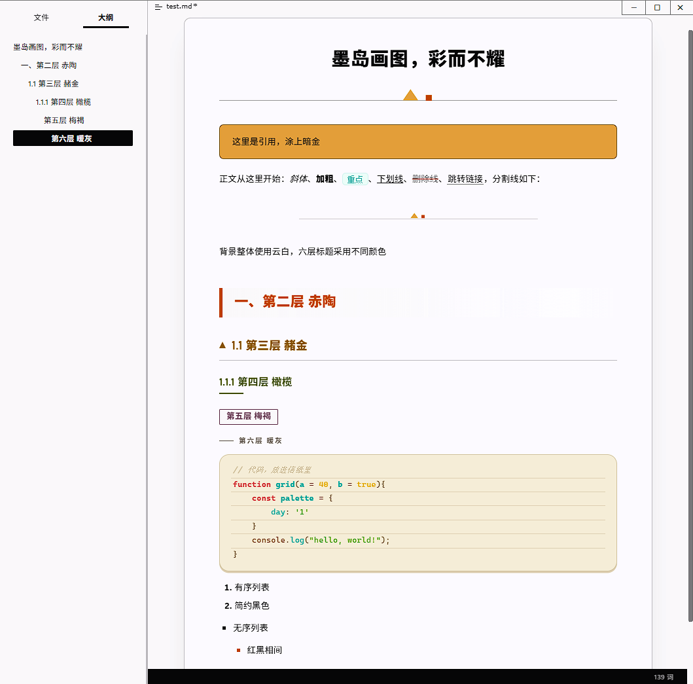

# 石墨岛 · 六色谱 —— Typora 主题

> 一套柔和的包豪斯主题：五色定调，六层标题各占一色，用几何代替装饰。
> 石墨画结构，云白留呼吸，两个暖色口音负责说话。



## 安装

1. 下载本仓库，或只取 `graphite-island-spectrum.css` 一个文件。
2. 把它放进 Typora 的主题文件夹（**偏好设置 → 外观 → 打开主题文件夹**），要放在该目录的**顶层**。
3. 在 **主题** 菜单里选 **Graphite Island Spectrum**。如果没变化，重启一下 Typora（它会缓存主题样式）。

菜单里显示的名字来自文件名：`graphite-island-spectrum.css` → 石墨岛 · 六色谱。

## 设计

### 五色，不多一味

| 令牌 | 色值 | 用途 |
| --- | --- | --- |
| `--bb-ink` | `#1D1D1F` | 全部文字、1px 结构线、深色面 |
| `--bb-paper` | `#FBFBFD` | 页面与卡片底 |
| `--bb-amber` | `#D8A24B` | 三角、高亮、色块填充、引言块底 |
| `--bb-clay` | `#BF4800` | 方形、状态、主按钮、hover、危险提示 |
| `--bb-mist` | `#F5F5F7` | 灰底区块、40px 图纸网格、分隔线 |

主题里其余所有颜色都是这五色的提亮或压暗，不会有第六种颜色混进来。

### 六层标题，六色

| 层级 | 色味 | 色值 |
| --- | --- | --- |
| H1 | 石墨 | `#1D1D1F` |
| H2 | 赤陶 | `#BF4800` |
| H3 | 赭金 | `#8A5E14` |
| H4 | 橄榄 | `#55602F` |
| H5 | 梅褐 | `#6B4A5B` |
| H6 | 暖灰 | `#6B645D` |

六个色相拉得很开（23° → 37° → 83° → 326°），所以一眼能认出层级；明度收在同一条窄带里，所以它们不会互相打架。六色在纸面上都保持 **4.5:1** 以上，正文是 **16.2:1**。

### 几何

用 1px 结构线代替柔和阴影，只留一道 3px 平投影当作“卡片被抬起”，圆角 18px，卡片内边距 18/20px，绘图台背景上印着一层很淡的 40px 图纸网格（每 200px 一道大格线）。章节标题前带一枚小三角与方块作记号。

### 代码区

代码区刻意使用一套独立的暖色子色板，与正文五色板分开：暖砂纸底 `#efe9d6`、2px 浅砂边、18px 圆角、3px 平投影，语法色用薄荷 / 红 / 琥珀 / 绿区分。行内代码、代码块、CodeMirror 与源码模式共用这一张暖色卡片。

有一处是刻意为之：Typora 把 CodeMirror 的每一行都渲染成独立的 `<pre>`，而它自带的 `.CodeMirror pre` 重置并没有重置 `box-shadow`，于是卡片的 3px 投影会漏到每一行上，在代码行间画出一道 3px 砂色线。这里把这道漏出的线收细到 **1px**，只留一条极轻的行基线；源码模式下则完全去掉。卡片本身其他部分不变。

## 覆盖范围

H1–H6 及各自的记号、正文、高亮与 `<mark>`、链接、强调与删除线、有序/无序列表、任务列表、表格、脚注、引言块与嵌套引言、行内代码与代码块、源码模式、选区颜色、侧栏/大纲/页脚底色，以及打印与“减少动态效果”的适配。

以下未做自定义（不是坏了，只是保留 Typora 默认）：Mermaid 图、目录 TOC、GitHub 风格提示块、`<kbd>` 按键、行内公式。

## 实用说明

- **零外部依赖。** 没有 `@import`、没有网络字体、没有远程图片——两枚装饰记号是内联的 `data:` SVG。离线可用，导出 PDF 干净。
- **无需安装字体。** 正文优先 `Noto Sans SC` / `MiSans` / `Microsoft YaHei` / `PingFang SC`；标题优先 `Bahnschrift`；代码优先 `JetBrains Mono` / `Cascadia Code` / `SF Mono` / `Consolas`。每套字体栈都以系统字体兜底。
- **正文排版** 16px / 1.85 行高，为长文中英文阅读调过。
- **打印 / PDF** 会去掉 40px 网格、边框、圆角与阴影，只留墨。
- **减少动态效果** 在系统开启该设置时压缩所有过渡。
- **在 Windows 11 + Typora 1.14.15 上测试通过。** macOS 与 Linux 预期可用，但未完整测试，本主题也没有针对平台的 unibody 样式。

## 自定义

所有颜色都在 CSS 顶部的 `:root` 令牌块里，改这五个值就能整体换肤，且保持一致：

```css
:root {
  --bb-ink:   #1D1D1F;   /* 全部结构 */
  --bb-paper: #FBFBFD;   /* 页面与卡片 */
  --bb-amber: #D8A24B;   /* 暖色口音 */
  --bb-clay:  #BF4800;   /* 强口音 */
  --bb-mist:  #F5F5F7;   /* 灰底 */
}
```

标题六色是六个独立令牌（`--bb-h1` … `--bb-h6`），想把它们压成同一个颜色也不用动别的地方。

## 许可证

MIT —— 见 [LICENSE](LICENSE)。
